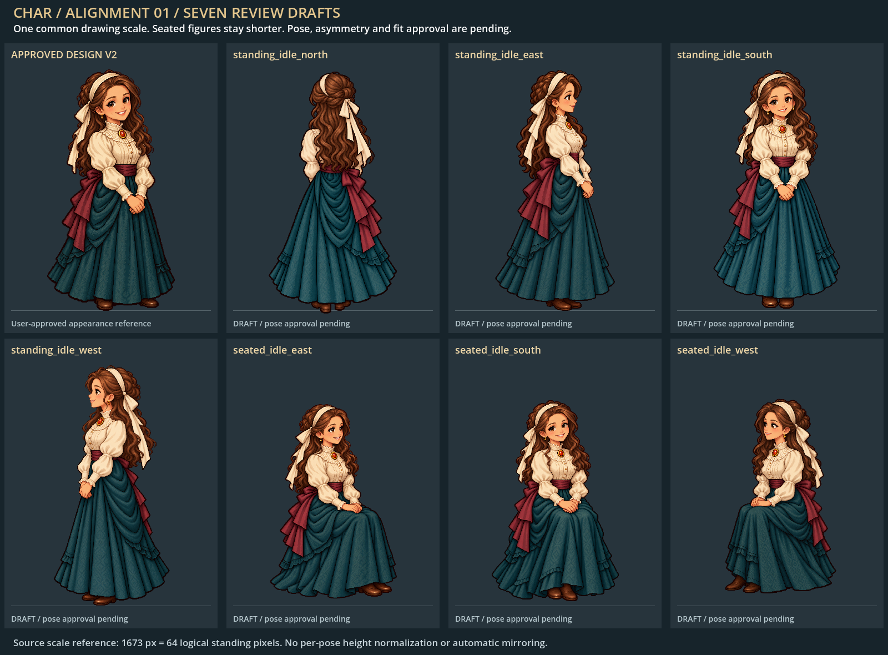
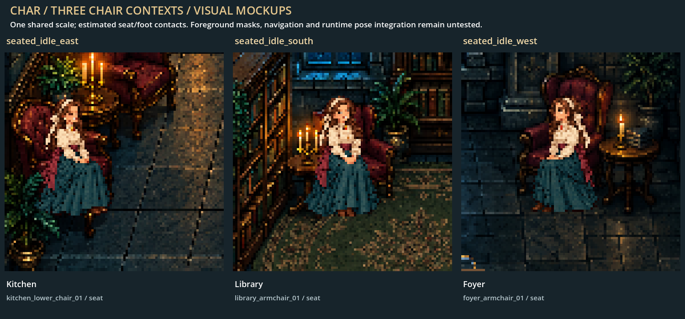

# Char — seven alignment samples for review

Current status (2026-10-23): all seven alignment_01 artwork samples are user-approved. Original review images/labels and executed prompts are preserved; contact calibration, masks and runtime integration remain pending. See [next-phase plan](CHARACTER_DIRECTIONAL_PIPELINE_PLAN.md).

**Artwork samples approved; runtime fit pending.** The approved likeness-v2 appearance is preserved as
the primary input to seven separate built-in image-generation requests. No walking,
emotional/reveal poses, other characters, runtime pose integration or final approval
were added. Personality/guilt remain unassigned.



[Open image gallery](../assets/characters/poses/char/review/alignment_01/index.html)
or [production manifest](../assets/characters/poses/char/production-manifest.json).

## Individual samples and exact production records

| Pose | Padded transparent draft | Exact prompt/inputs/output/landmarks |
| --- | --- | --- |
| Standing north | [PNG](../assets/characters/poses/char/exports/north/char_standing_idle_north_neutral.png) | [Record](../assets/characters/poses/char/prompts/alignment_01/standing_idle_north.json) |
| Standing east | [PNG](../assets/characters/poses/char/exports/east/char_standing_idle_east_neutral.png) | [Record](../assets/characters/poses/char/prompts/alignment_01/standing_idle_east.json) |
| Standing south | [PNG](../assets/characters/poses/char/exports/south/char_standing_idle_south_neutral.png) | [Record](../assets/characters/poses/char/prompts/alignment_01/standing_idle_south.json) |
| Standing west | [PNG](../assets/characters/poses/char/exports/west/char_standing_idle_west_neutral.png) | [Record](../assets/characters/poses/char/prompts/alignment_01/standing_idle_west.json) |
| Seated east | [PNG](../assets/characters/poses/char/exports/east/char_seated_idle_east_neutral.png) | [Record](../assets/characters/poses/char/prompts/alignment_01/seated_idle_east.json) |
| Seated south | [PNG](../assets/characters/poses/char/exports/south/char_seated_idle_south_neutral.png) | [Record](../assets/characters/poses/char/prompts/alignment_01/seated_idle_south.json) |
| Seated west | [PNG](../assets/characters/poses/char/exports/west/char_seated_idle_west_neutral.png) | [Record](../assets/characters/poses/char/prompts/alignment_01/seated_idle_west.json) |

Native masters remain immutable under `assets/characters/poses/char/masters/alignment_01/`.
The redundant combined prompt files were removed; retained per-pose records contain exact strings, ordered reference
hashes, tool settings and returned file basenames. Every request used the approved
v2 master; seated jobs also used the relevant room image for chair geometry only.
No photographs or rejected realistic face were used.

## Seated room-context previews



| Sample | Exact contact | Full room + closeup |
| --- | --- | --- |
| Seated east | `g_kitchen::kitchen_lower_chair_01::seat` | [Kitchen](../assets/characters/poses/char/review/alignment_01/seated_idle_east--context.png) |
| Seated south | `g_library::library_armchair_01::seat` | [Library](../assets/characters/poses/char/review/alignment_01/seated_idle_south--context.png) |
| Seated west | `g_foyer::foyer_armchair_01::seat` | [Foyer](../assets/characters/poses/char/review/alignment_01/seated_idle_west--context.png) |

These are **visual mockups** using native Compatibility-rendered room plates and
a temporary review overlay. Existing runtime props are retained; other actors/HUD
are hidden. The normal game was not changed to use the new poses. Chair-arm and
front-edge masks are missing; overlap, body/skirt fit, pathing, collision, occupancy
and actual pose/contact selection are untested. Orange/cyan points in individual
room sheets show estimated seat/floor-feet landmarks. Local approach clearance
comes from the earlier room-tag audit and is not proof that the body fits.

## Common scale and export measurements

All samples use the approved v2 standing opaque height **1673 source pixels** as
one shared reference: `64 / 1673` source-to-logical scale. No per-pose normalization,
anatomy stretching, color edits or automatic mirroring was performed. Native
canvases are 916×1716, except the east/west standing outputs are 917×1716. The
one-pixel width variation is not corrected by resizing.

| Pose | Opaque source height | Logical occupied height at shared scale |
| --- | ---: | ---: |
| Standing north | 1676 | 64.115 |
| Standing east | 1671 | 63.923 |
| Standing south | 1654 | 63.273 |
| Standing west | 1668 | 63.809 |
| Seated east | 1348 | 51.567 |
| Seated south | 1395 | 53.365 |
| Seated west | 1348 | 51.567 |

Seated art remains naturally shorter with a common drawing scale. Some native
standing outputs have tight top padding despite the prompt; the technical draft
exports add **64 transparent pixels at top/left**, with at least 64 around every
source canvas, on a common **1045×1844** canvas. Source pixels are copied unchanged;
the added blank canvas is not an individual height adjustment. Export contact
landmarks are the source landmarks plus `[64,64]`. Final production canvas and
display-resolution decisions remain open; these are lossless review exports.

Feet and seated pelvis/seat landmarks are **manual visual estimates**, not approved
anatomical calibration. Per-pose records include head/crown estimates where visible,
seat/feet, relative skirt envelope, world-floor estimates and original contact data.
The conservative lower-body envelope is not a physical floor collision footprint.

## Review questions and remaining work

- Preserve the approved likeness and cartoon eye/face treatment in every visible view?
- Accept the back/profile interpretations, head proportions, hands and costume folds?
- Confirm the anatomical side interpretation of the ribbon/hip bow. Independent
  generated views still require a side-consistency review; no mirror was applied.
- Approve seated silhouettes and skirt volume before refining chair contact/masks?

The current standing-only runtime normalizes each standalone image by its own
opaque height. It must not be used unchanged for seated art. The review tool uses
the explicit shared reference and contact landmarks locally; it is not a completed
shared runtime adapter. User approval of these samples precedes final integration.

## Reproduction and validation

Use configured graphical Godot:

```powershell
godot --path . --script tools/render_char_alignment_review.gd -- --npc-seed=20261023
python tools/validate_char_alignment.py
python tools/audit_character_poses.py
python tools/audit_character_poses.py --check
python tools/validate_character_pose_audit.py
```

`godot` denotes the locally configured executable. The native run completed without
Godot errors, exporting seven padded drafts and five review images. Validation
checks source/input hashes, transparent PNGs, exact recovered source pixels,
landmark/padding transforms, common scale, natural shorter seated extents, contact
IDs and output dimensions. Reports: `test-results/char-alignment-review.log` and
`test-results/char-alignment-validation.json`. These checks do not approve artwork.
